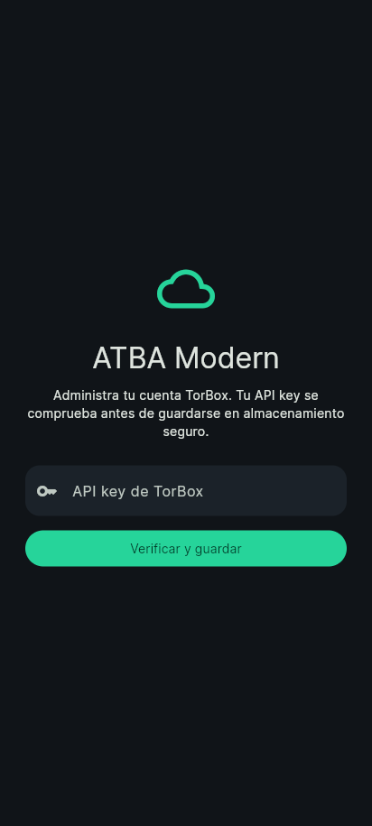

# ATBA Modern

Cliente independiente para **administrar TorBox**, basado en [ATBA de 93Pd9s8Jt](https://github.com/93Pd9s8Jt/atba). Flutter, Dart, Material Design 3, Provider y SQLite/Drift. La navegación se centra en **Inicio · Descargas · Automatizaciones · Cuenta**; no incluye catálogo de películas ni Stremio.

> Versión de desarrollo. La compilación y las pruebas automatizadas no sustituyen la comprobación con una cuenta y un teléfono Android reales. Consulta [las limitaciones](docs/KNOWN_LIMITATIONS.md) y [las pruebas](docs/TEST_REPORT.md).

## Funciones implementadas

- Dashboard con identidad, plan, vencimiento, estadísticas y ancho de banda devueltos por TorBox; contadores calculados sobre la biblioteca paginada.
- Biblioteca unificada de torrents, Usenet, web y cola; búsqueda, filtros, ordenación, vista compacta/tarjetas y selección múltiple. Las operaciones disponibles respetan el tipo de transferencia.
- Progreso real con un único ciclo de consulta, sin una petición por cada fila. Comparte estado con el explorador, descubre altas externas y conserva datos anteriores ante fallos.
- Añadir magnets y URLs, importar `.torrent`/`.nzb`, lotes de hasta 20 enlaces, consulta de caché de magnets y revisión de enlaces compartidos desde Android antes de enviarlos.
- Explorador con búsqueda, ordenación, selección múltiple, enlaces individuales/múltiples, descarga al dispositivo, compartir en Android, previsualización y envío a Google Drive.
- Google Drive: sesión segura persistente, migración de claves antiguas, detección de expiración y eliminación local independiente de TorBox. No se fabrica una renovación de OAuth.
- Trabajos de integración: progreso remoto independiente, actualización automática y cancelación mediante el endpoint documentado.
- Centro de notificaciones TorBox, filtros y eliminación individual/todas con confirmación.
- RSS: alta, edición, pausa, reanudación, revisión, eliminación y elementos detectados. Incluye filtros y control de duplicados cuando TorBox devuelve el valor. Requiere **Pro**; intervalo mínimo documentado de 10 minutos.
- Preferencias de cuenta: notificaciones, ZIP, siembra, CDN y carpeta de Drive disponibles en la respuesta actual. Solo se envían campos editados, sin valores nulos.
- Suscripciones y transacciones de consulta; los importes se presentan como los entrega la API, sin asumir una moneda ausente.
- Temas claro, oscuro y automático, Inter y colores dinámicos de Android.
- Avisos locales opcionales sobre finalizaciones/fallos detectados en primer plano. No son push ni prometen funcionar instantáneamente con la app cerrada.



La captura corresponde al arranque sin una cuenta configurada, no a métricas inventadas.

## Instalar desde Android, sin computadora

Primera compilación disponible: [APK ARM64 como artifact de GitHub Actions](https://github.com/Eibyx/AtbaModern/actions/runs/39239270267/artifacts/12181266127). Para la versión más reciente, consulta los checks del PR y los artifacts de la última ejecución exitosa.

1. Abre [GitHub Actions](https://github.com/Eibyx/AtbaModern/actions/workflows/debug.yml) en el navegador.
2. Ejecuta `debug.yml` / **ATBA Modern · Validate and APK** y elige la rama `feat/atba-modern-overhaul` mientras el PR esté pendiente. Tras fusionarlo, utiliza `main`.
3. Espera a que terminen **validate** y **android**. Descarga el artifact `ATBA-Modern-Android-<commit>` del resumen de la ejecución.
4. Extrae el ZIP e instala **ATBA-Modern-arm64-v8a.apk**. Android puede pedir permiso al navegador/gestor de archivos para instalar aplicaciones de esa fuente.
5. El APK universal puede generarse marcando `universal` en la ejecución manual.

Los artifacts caducan a los 14 días; puede ejecutarse de nuevo el workflow. Si una ejecución falla, abre el paso fallido para ver su diagnóstico. Nunca se publican releases oficiales automáticamente desde este workflow.

**Requisitos Android:** ARM64; mínimo API 24 (Android 7) fijado por Flutter 3.47.5. La prueba física del APK sigue siendo necesaria. Identificador propio: `com.eibyx.atbamodern.debug` para prueba y `com.eibyx.atbamodern` para producción. Permite coexistir con ATBA original y no hereda su almacenamiento al instalarlo por primera vez.

El APK de prueba utiliza la firma debug estándar generada por Android, no una identidad de publicación inventada. Un runner nuevo puede generar otra firma: para actualizar una instalación con distinta firma puede ser necesario desinstalarla, perdiendo sus datos locales. Una distribución estable requiere configurar una clave de producción propia.

## Configurar TorBox y Google Drive

Introduce tu API key en el acceso inicial. Se valida mediante `/v1/api/user/me` antes de sustituir la anterior; queda en FlutterSecureStorage. No se aplica ningún referido ni se realizan mutaciones adicionales sobre la cuenta.

En **Cuenta → Google Drive**, inicia la autorización de TorBox. Si Google rechaza la ventana integrada, utiliza **Autorizar desde el navegador** y pega explícitamente la URL de éxito o el token en el campo protegido. Se acepta únicamente el callback HTTPS de `torbox.app/oauth/google/success`; no se copia el token automáticamente al portapapeles.

La credencial y su expiración se guardan en un registro seguro. Un token expirado se conserva para diagnóstico local, pero no se envía como vigente. Un token manual sin fecha se muestra como de vigencia sin verificar. Los errores temporales no borran la conexión. No se ha documentado un mecanismo público de renovación local de Google; al caducar, será necesario reconectar.

La API key de TorBox y el OAuth de Google son distintos. Eliminar una no elimina la otra. Eliminar la credencial local de Google no revoca permisos en otros dispositivos; la revocación global se gestiona en Google/TorBox.

## Actualizaciones automáticas

Mientras Inicio o Descargas están visibles y la aplicación está en primer plano, la biblioteca consulta las categorías aproximadamente cada **6 segundos** si hay actividad y cada **30 segundos** si está inactiva. El siguiente ciclo comienza tras terminar el anterior. Se utiliza paginación de 1.000 elementos y se espacian páginas de cuentas grandes.

Ante fallos, hay reintentos limitados para GET y backoff de 8 a 120 segundos. Se respeta `Retry-After`. Los POST de creación no se reintentan automáticamente para evitar duplicados. Al volver de segundo plano o regresar a la biblioteca se reanuda la consulta. La API documenta 300 solicitudes/minuto por token y 60 torrents no cacheados/hora.

Las barras distinguen **descarga en TorBox**, **trabajo a un servicio remoto** y **descarga al dispositivo**. El envío a Google informa de que el trabajo fue encolado; no simula una transferencia ya completada. El gestor nativo gestiona las descargas al teléfono y sus notificaciones.

## Compilación y pruebas

Herramientas: Flutter **3.47.5** (Dart **3.13.4**), JDK 17, Android SDK 36 y NDK `28.2.13676358`. Las dependencias Git existentes están fijadas por commit. En Linux las pruebas Drift necesitan `libsqlite3-dev`.

```bash
flutter pub get --enforce-lockfile
bash tool/ci_verify.sh
flutter build apk --debug --target-platform android-arm64
```

El verificador instala los paquetes internos, genera código, ejecuta `dart format --output=none --set-exit-if-changed .`, `flutter analyze`, pruebas raíz, API y parser. Las pruebas en vivo de TorBox requieren una credencial real y quedan fuera de CI; no se necesita una cuenta para los mocks.

Para una compilación firmada de producción, configura en los **secrets de GitHub Actions** `ANDROID_KEYSTORE_BASE64`, `ANDROID_STORE_PASSWORD`, `ANDROID_KEY_ALIAS` y `ANDROID_KEY_PASSWORD`, y ejecuta manualmente `build-release.yml`. No introduzcas valores en el código ni en issues. El workflow guarda un artifact firmado; no publica una release. La clave debe conservarse de forma segura para futuras actualizaciones.

## Documentación y licencia

- [Auditoría técnica y estados](docs/AUDIT_REPORT.md)
- [Plan y dependencias técnicas](docs/IMPLEMENTATION_PLAN.md)
- [Cambios de Modern](docs/CHANGELOG_MODERN.md)
- [Informe de pruebas](docs/TEST_REPORT.md)
- [Limitaciones conocidas y escenarios manuales](docs/KNOWN_LIMITATIONS.md)
- [Contrato oficial consultado](docs/TORBOX_API_CONTRACT.json)
- [Revisión de avisos de dependencias](docs/DEPENDENCY_REVIEW.json)

Se conserva [GPL-3.0](LICENSE), la atribución de ATBA original y las licencias de sus dependencias. ATBA Modern no es una aplicación oficial de TorBox. Android es el objetivo de este trabajo; iOS/macOS/Windows/Linux no se anuncian como plataformas verificadas.
